  <picture>
    <source media="(prefers-color-scheme: dark)" srcset="./assets/hero-dark.svg" />
    <source media="(prefers-color-scheme: light)" srcset="./assets/hero-light.svg" />
    
  </picture>

  <a href="https://pradeepmathias.vercel.app/">Portfolio</a>
  &nbsp;&nbsp;·&nbsp;&nbsp;
  <a href="https://www.linkedin.com/in/pradeep-mathias-98a938221">LinkedIn</a>
  &nbsp;&nbsp;·&nbsp;&nbsp;
  <a href="mailto:pradeepmathias2003@gmail.com">pradeepmathias2003@gmail.com</a>

 

I’m **Pradeep Mathias**, a Business & Data Analyst from Mangaluru (**MSc Data Science**, 8.5 CGPA · **BSc Mathematics**, 7.4 CGPA). I turn operational and behavioral datasets into **SARIMA forecasts**, **SQL & Power BI dashboards**, and **RAG pipelines** — previously interning at **New Mangalore Port Authority (NMPA)** and **Engagesphere (Euron)**.

---

### Experience & selected work

  <picture>
    <source media="(prefers-color-scheme: dark)" srcset="./assets/work-analytics-dark.svg" />
    <source media="(prefers-color-scheme: light)" srcset="./assets/work-analytics-light.svg" />
    
  </picture>

  <picture>
    <source media="(prefers-color-scheme: dark)" srcset="./assets/work-ai-dark.svg" />
    <source media="(prefers-color-scheme: light)" srcset="./assets/work-ai-light.svg" />
    
  </picture>

  <a href="https://pradeepmathias.vercel.app/#work">All case studies</a>
  &nbsp;&nbsp;·&nbsp;&nbsp;
  <a href="https://github.com/pradeepmathias02/nutrigpt">NutriGPT</a>
  &nbsp;&nbsp;·&nbsp;&nbsp;
  <a href="https://github.com/pradeepmathias02/QnA-rag">QnA RAG</a>
  &nbsp;&nbsp;·&nbsp;&nbsp;
  <a href="https://github.com/pradeepmathias02/localone">Aegis</a>

---

### Technical stack & credentials

- **Analytics & BI** — SQL, Excel, Power BI, Tableau, Data Cleaning, EDA, KPI Dashboards, Data Modeling
- **Python, ML & AI** — Python, Pandas, NumPy, Matplotlib, Seaborn, Scikit-Learn, SARIMA, NLP, LangChain, RAG
- **Data & Engineering** — MySQL, MongoDB, Snowflake, ETL Pipelines, dbt, AWS S3, PySpark, FastAPI, Streamlit
- **Certifications** — HarvardX Data Science (ML) · Deloitte Australia Analytics · Google AI Essentials · British Airways DS

GitHub activity

 

  <picture>
    <source media="(prefers-color-scheme: dark)" srcset="https://github-readme-stats.shion.dev/api?username=pradeepmathias02&theme=github_dark&hide_border=true&bg_color=0d1117&include_all_commits=true" />
    
  </picture>
  &nbsp;&nbsp;
  <picture>
    <source media="(prefers-color-scheme: dark)" srcset="https://github-readme-stats.shion.dev/api/top-langs/?username=pradeepmathias02&theme=github_dark&hide_border=true&bg_color=0d1117&layout=compact" />
    
  </picture>

