  
  
  

## About me

I’m Pradeep, a Data Analyst from Mangaluru. At **New Mangalore Port Authority (NMPA)**, I analyzed 58 months of maritime operations and built SARIMA models to forecast cargo throughput. At **Euron (Engagesphere Technology)**, I built **WellNest AI** with behavioral sentiment telemetry and automated reporting.

I hold an **M.Sc. in Data Science** and a **B.Sc. in Mathematics**, and I’m open to **Data Analyst** and **Business Analyst** opportunities.

## Analytics highlights

| Work | Result |
| --- | --- |
| Port cargo forecasting | Modeled **58 months** of maritime telemetry with **96.4% historical fit**, projecting **6.22M MT** for berth planning. |
| Retail revenue intelligence | Analyzed **10,000+ transactions** across RFM cohorts, surfacing **+24.8% retention** and **$1.4M CLV** impact. |
| Behavioral telemetry (WellNest AI) | Built FastAPI + MongoDB pipelines scoring sentiment at **94.2% accuracy** with automated PDF/CSV reports. |
| Nutrition RAG search (NutriGPT) | Indexed **8,000+ verified items** in ChromaDB with semantic retrieval for grounded, zero-hallucination Q&A. |

## Tech stack

More tools I work with

- **Analytics & BI** · Tableau, DAX, KPI Dashboards, EDA, Statistics
- **Forecasting & ML** · SARIMA Time-Series, Statsmodels, NumPy, Matplotlib, Seaborn
- **Data systems** · MySQL, MongoDB, Snowflake, dbt, PySpark, AWS S3
- **AI & engineering** · LangChain, ChromaDB, RAG, Streamlit, Git, Docker

## Project dossiers

[All Dossiers · Portfolio](https://pradeepmathias.vercel.app/#work) · [NutriGPT · Repository](https://github.com/pradeepmathias02/nutrigpt) · [QnA RAG · Repository](https://github.com/pradeepmathias02/QnA-rag) · [Aegis · Repository](https://github.com/pradeepmathias02/localone)

**[Visit my portfolio ↗](https://pradeepmathias.vercel.app/)**

<strong>📊 GitHub activity</strong>

