  <picture>
    <source media="(prefers-color-scheme: dark)" srcset="./assets/hero-dark.svg" />
    <source media="(prefers-color-scheme: light)" srcset="./assets/hero-light.svg" />
    
  </picture>

  <a href="https://pradeepmathias.vercel.app/"><strong>Portfolio ↗</strong></a>
  &nbsp;&nbsp;·&nbsp;&nbsp;
  <a href="https://www.linkedin.com/in/pradeep-mathias-98a938221"><strong>LinkedIn ↗</strong></a>
  &nbsp;&nbsp;·&nbsp;&nbsp;
  <a href="mailto:pradeepmathias2003@gmail.com"><strong>Email ↗</strong></a>

 

I’m **Pradeep Mathias**, an M.Sc. Data Science and B.Sc. Mathematics graduate from Mangaluru focused on turning operational data into econometric forecasts, executive BI dashboards, and grounded AI systems. Previously worked as a Data Analyst Intern at **New Mangalore Port Authority (NMPA)** and AI Developer Intern at **Euron**.

### Selected work

  <picture>
    <source media="(prefers-color-scheme: dark)" srcset="./assets/showcase-dark.svg" />
    <source media="(prefers-color-scheme: light)" srcset="./assets/showcase-light.svg" />
    
  </picture>

  <a href="https://pradeepmathias.vercel.app/#work">Interactive Case Studies ↗</a>
  &nbsp;·&nbsp;
  <a href="https://github.com/pradeepmathias02/nutrigpt">NutriGPT</a>
  &nbsp;·&nbsp;
  <a href="https://github.com/pradeepmathias02/QnA-rag">QnA RAG</a>
  &nbsp;·&nbsp;
  <a href="https://github.com/pradeepmathias02/localone">Aegis</a>

### Experience & metrics

- **Port Operations Forecasting (NMPA)** — Modeled 58 months of vessel & cargo telemetry with SARIMA (`96.4%` historical fit) to project `6.22M MT` for 2026 berth planning.
- **Retail Revenue Intelligence** — Engineered Python + SQL + Power BI cohorts over `10,000+` transactions (`+24.8%` RFM retention, `$1.4M` projected CLV).
- **WellNest AI (Euron)** — Built FastAPI & MongoDB behavioral sentiment pipelines (`94.2%` accuracy) with automated PDF/CSV reporting.
- **NutriGPT** — Grounded Llama 3 retrieval over `8,000+` verified food records in ChromaDB (`0.14s` query time, zero hallucination).

### Core stack

`Python` · `SQL` · `Power BI` · `Excel` · `Pandas` · `PostgreSQL` · `SARIMA` · `Scikit-Learn` · `FastAPI` · `MongoDB` · `LangChain` · `ChromaDB`

More tools & GitHub activity

 

- **Analytics & BI** — Tableau, Dynamic DAX, EDA, Hypothesis Testing, Matplotlib, Seaborn
- **Data & Cloud** — MySQL, Snowflake, dbt, PySpark, AWS S3, Docker, Git

 

  <picture>
    <source media="(prefers-color-scheme: dark)" srcset="https://github-readme-stats.shion.dev/api?username=pradeepmathias02&theme=github_dark&hide_border=true&bg_color=0d1117&include_all_commits=true" />
    
  </picture>
  <picture>
    <source media="(prefers-color-scheme: dark)" srcset="https://github-readme-stats.shion.dev/api/top-langs/?username=pradeepmathias02&theme=github_dark&hide_border=true&bg_color=0d1117&layout=compact" />
    
  </picture>

